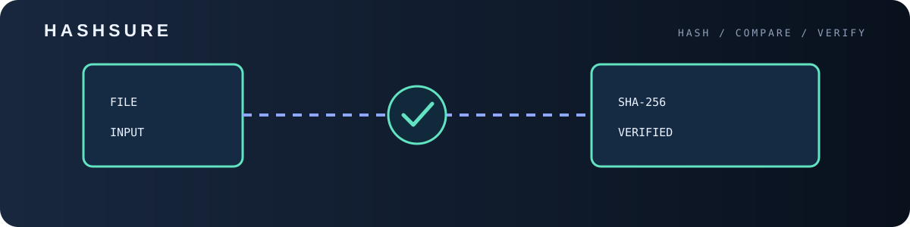
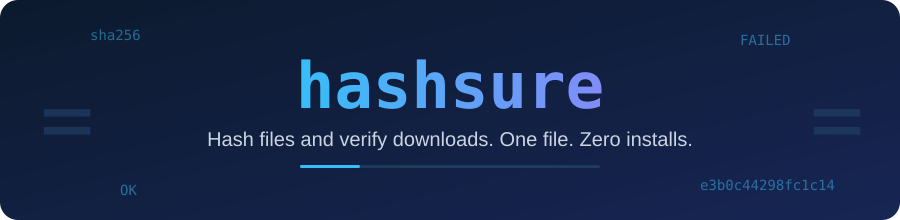

<p align="center">

<p align="center"></p>
  
</p>

<p align="center">
  
  
  
</p>

**hashsure** is a single Python file for checksums: hash a file or a whole folder, verify a download against the hash
the publisher gave you, or check a `SHA256SUMS` list. No `pip install`, no dependencies. Download one file and run it.

<p align="center">
  
</p>

## Run

```bash
python hashsure.py file.zip
```

Or grab just the file:

```bash
curl -O https://raw.githubusercontent.com/ERROR404DTIR/hashsure/main/hashsure.py
```

## Options

| Option | What it does |
|---|---|
| `paths` | Files to hash (folders need `-r`) |
| `-a, --algo` | `md5`, `sha1`, `sha256` (default), `sha512`, `blake2b` |
| `-r, --recursive` | Hash folders recursively |
| `--expect HASH` | Verify one file against a hash. The algorithm is detected from its length |
| `--verify SUMFILE` | Check every `hash  name` line of a checksum file (paths are relative to that file) |
| `-o, --output FILE` | Write `hash  name` lines to a file (same format as `sha256sum`) |

Exit code is `1` when a check fails, so it works in scripts and CI.

## Examples

```bash
python hashsure.py ubuntu.iso --expect 9f86d081884c7d659a2feaa0c55ad015...
python hashsure.py -r dist -o SHA256SUMS
python hashsure.py --verify SHA256SUMS
python hashsure.py backup.tar -a sha512
```

## Why

- **One file**, readable in a few minutes
- **Zero dependencies**: only the Python standard library
- **Safe**: read-only, files are streamed in chunks so huge files are fine
- Compatible with `sha256sum` / `md5sum` list files
- Works on Windows, Linux and macOS

## License

MIT